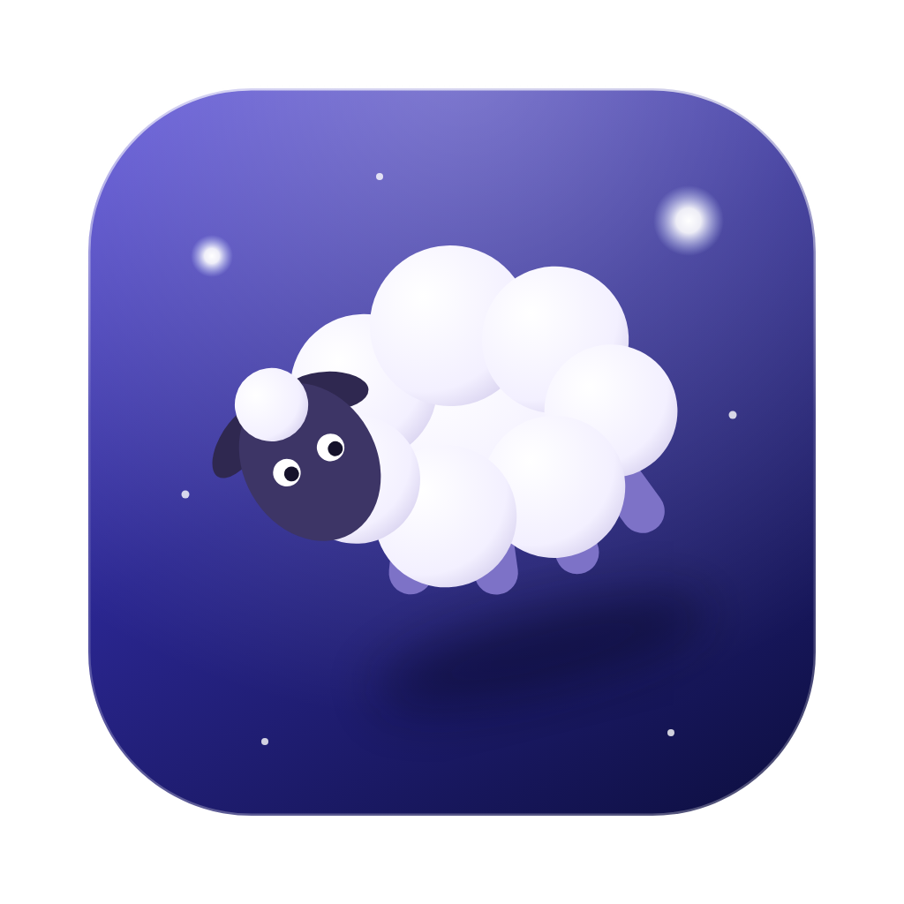

<p align="center">
  
</p>

# spaceherd

herdr, with VS Code beside it for the spaces you want it in. Switching a space
in herdr switches VS Code to that space's folder, locally or on an SSH
machine. Spaces without VS Code show herdr across the whole window.

## Install

Download the latest build for your system from
[Releases](https://github.com/sebastian-ruiz/spaceherd/releases):

- **macOS:** `Spaceherd-<version>-mac-arm64.dmg` (Apple silicon) or
  `-mac-x64.dmg` (Intel). Drag Spaceherd into Applications and open it from
  there. The app isn't signed with an Apple Developer ID, so macOS blocks the
  first launch: open *System Settings → Privacy & Security* and click *Open
  Anyway* (or run
  `xattr -dr com.apple.quarantine /Applications/Spaceherd.app`). That's only
  needed once; updates install without it.
- **Linux:** the `.deb` (`sudo apt install ./Spaceherd-<version>-linux-<arch>.deb`)
  or the `.AppImage` (`chmod +x` it and run it). AppImages need FUSE 2
  (`libfuse2` on Ubuntu). On Ubuntu 24.04 and later, AppArmor may stop
  Electron's sandbox in an AppImage; the `.deb` doesn't have that problem.

## Updates

The packaged app checks GitHub Releases shortly after starting and every six
hours, downloads a new version in the background and installs it when you
quit, or right away with *Spaceherd → Restart to Update*. Your herdr spaces,
agents and VS Code servers keep running across the restart. *Check for
Updates…* checks now. On Linux the menu item is under *Help*.

- **macOS** and the Linux **AppImage** update themselves. Updates are signed
  with spaceherd's own key and checked against it before installing, so no
  Apple Developer ID is needed. The app has to be somewhere it can replace
  itself: in Applications, not run from the `.dmg` or from Downloads.
- The **`.deb`** shows a notification when a new version is out.
- Set `"updates": "off"` in the config to never check.

## Run from source

```sh
npm install
npm start
```

Requirements: [herdr](https://herdr.dev) and VS Code's `code` CLI on your
`PATH`, on every machine you use. The first start of `code serve-web` on a
machine downloads the VS Code server, which takes a minute or two.

spaceherd starts VS Code's server (`code serve-web`) with
`--accept-server-license-terms`, so using spaceherd means accepting the
[Visual Studio Code Server license terms](https://aka.ms/vscode-server-license)
and the [Microsoft Privacy Statement](https://privacy.microsoft.com/en-US/privacystatement).
They are Microsoft's terms for that server, separate from spaceherd's license.

The left pane attaches to your normal herdr session, the same one you get by
running `herdr` in any terminal. Closing the app detaches; agents keep running.

### Laptop and desktop

herdr's spaces live in the herdr server of the machine they run on. Work from
the laptop with the desktop added as an SSH machine, close the laptop, and run
spaceherd on the desktop: it attaches to the same herdr session and the same
VS Code server, so the same spaces, agents and files are there. VS Code's
open editors and layout are kept per client, so those don't follow you.
Running spaceherd on a machine needs Node.js there for `npm install`.

## How it works

- **Which space is active:** herdr writes `"{hostname}: {workspace}"` as the
  window title of the terminal it runs in. The app is that terminal. The
  hostname picks the machine, and that machine's herdr focus picks the space.
  An SSH machine's hostname is learned on its first connection and
  remembered. Keep herdr's `ui.window_title` at its default. At startup herdr
  shows alone until its space has held for a second, so spaces it passes
  through while restoring don't load VS Code.

  *Temporary:* the title's space name is ignored because of
  [herdr#3200](https://github.com/herdrdev/herdr/issues/3200): for a space
  that was never renamed, herdr's title names the directory it was created
  from. The herdr focus is shared by every client attached to a machine, so
  while another herdr client (for example herdr running on that machine
  itself) switches spaces, VS Code follows it. Renaming a space once fixes
  its title in herdr too. Once the issue is fixed, spaceherd should prefer
  the title's space name again (see `resolveSpace` in `src/main/spaces.js`).
- **VS Code per space:** off until you turn it on with *View → VS Code for
  This Space* (Ctrl+Cmd+E; Ctrl+Alt+Shift+E on Linux). The choice is kept per
  space. Turning it off closes that space's view and its extension host.
  Switching between a space with VS Code and one without resizes herdr, so
  the programs in its panes redraw.
- **Which folder:** the focused pane's working directory when you turn VS
  Code on, pinned, so a later `cd` doesn't move VS Code. *View → Pin VS Code
  Folder to Focused Pane* re-pins it. `folderOverrides` in the config wins
  over both.
- **VS Code:** one `code serve-web` per machine on a fixed port, and one
  Electron view per space. Views stay loaded while hidden, so switching back is
  instant. The `maxLiveViews` most recently used views are kept, and views
  not shown for `idleViewMinutes` are closed. Each loaded view also runs an
  extension host (with its language servers) on its machine's server; views
  are closed the way a browser closes a tab, also when the app quits, so the
  server ends those right away. Coming back to a closed view reloads it,
  which takes a few seconds. The server
  and its token (`~/.config/spaceherd/vscode-token` on that machine) are
  shared by every spaceherd that uses the machine, locally or over SSH, and
  the server keeps running when the app quits. If another server with a
  different token holds the port, the VS Code pane says so.
- **Links:** Cmd+click (Ctrl+click on Linux) on a URL or file path in herdr
  opens it: URLs in the browser, files in the space's VS Code (turned on if
  it was off) through Quick Open, at `path:line:col` when given. Relative
  paths resolve from the focused pane's directory. herdr takes plain clicks;
  links are found in the visible text, so a hyperlink whose label isn't its
  target isn't opened.
- **Title bar:** dark or light to match herdr's theme, judged from the
  backgrounds herdr draws, not from the system appearance.
- **Shortcuts:** VS Code's shortcuts work while herdr has focus, as from
  VS Code's own terminal: the keys VS Code's terminal hands to VS Code move
  focus to VS Code and act there. On macOS that is every `Cmd` key except
  `Cmd+C/V/X/Q/W/H/M`; on Linux a fixed list (`Ctrl+P`, `Ctrl+E`,
  `Ctrl+Shift+P`, `F1`, `Ctrl+J`, `Ctrl+Tab`, `Ctrl+PageUp/Down`, `Ctrl+1..8`,
  `Ctrl+Shift+B`, debug keys). Everything else, including `Ctrl+C`, `Ctrl+B`
  and `Ctrl+K`, goes to herdr. See `src/main/shortcuts.js`.
- **Alerts:** the app reads each machine's herdr snapshot every 1.5 s. When an
  agent becomes *blocked* or *done* it shows a notification; clicking it focuses
  that space. The dock badge counts blocked agents. If you set herdr's
  `ui.toast.delivery = "terminal"`, herdr's own notifications appear too.

## Configuration

`~/.config/spaceherd/config.json` (*View → Open Config File*). It starts out
empty: add only what you want to change, so new defaults in later versions
still reach you. The options, with their defaults:

```json
{
  "herdr": { "command": "herdr", "args": [] },
  "machines": [
    { "id": "local", "type": "local", "hostnames": ["<this machine's hostname>"], "vscodePort": 47800 }
  ],
  "folderOverrides": {},
  "updates": "auto",
  "maxLiveViews": 4,
  "idleViewMinutes": 30,
  "vscodeUserSettings": {},
  "terminalWidth": 0.42,
  "terminal": { "fontFamily": "MesloLGS NF, JetBrainsMono Nerd Font, Menlo, monospace", "fontSize": 13, "macOptionIsMeta": false }
}
```

- `herdr`, `terminal` and `vscodeUserSettings` are merged with the defaults;
  other entries replace them.
- `machines` lists machines beyond those saved in herdr (which are added
  automatically; see below), or overrides the local one. A list given here
  replaces the default, so keep the local machine in it.
- `folderOverrides`: `"machineId:workspaceLabel": "/path"` fixes a space's
  VS Code folder, e.g. `{ "desktop:my-space": "/home/me/src/my-project" }`.

Ports must stay fixed: VS Code keeps its state per origin, which includes the
port.

### VS Code settings

VS Code in a browser keeps its user settings in the page's storage, not in a
file. Two ways to set them without doing it by hand in every machine's view:

- `~/.vscode-server/data/Machine/settings.json` on each machine, read by its
  VS Code server for every client. A symlink to the desktop app's
  `settings.json` shares those settings. VS Code skips application-scoped
  settings in this file.
- `vscodeUserSettings` in the config, written into the user settings of every
  view when it loads, for application-scoped settings and for settings meant
  only for spaceherd's VS Code. These values win over changes made in VS
  Code. The first time a machine's view gets them, it reloads once. The
  defaults: the full menu bar (`window.menuBarVisibility: "classic"`; VS Code
  in a browser otherwise shows a menu button), no chat or built-in AI
  (`chat.disableAIFeatures`), no terminal panel when a view opens
  (`terminal.integrated.hideOnStartup: "always"`), and the secondary side bar
  hidden for new folders. Entries in the config are added to these; `null`
  drops a default.

### SSH machines

Add the machine to herdr: `herdr machine add desktop`. That's all: the app
reads `herdr machine list` at start and every 15 s, and picks up new machines
with a stable local port each. The remote needs `code` (VS Code 1.86 or later)
on its `PATH`, and key-based SSH login (the app runs ssh with `BatchMode=yes`).

For each SSH machine the app keeps one `ssh` connection open. It forwards the
remote herdr socket (to `/tmp/spaceherd-<uid>/`) and the remote `serve-web`
port, and starts `serve-web` on the remote with `nohup`, so it survives
disconnects and is shared by all your clients. The remote owns the connection
token (`~/.config/spaceherd/vscode-token` there); clients read it over SSH.
The first start downloads the VS Code server on the remote.

herdr's title shows the remote's hostname when one of its spaces is selected;
the app learns that hostname over SSH. A machine entry in `machines` with the
same `id` as herdr's label overrides the imported one, e.g. to set
`codeCommand` or `remotePort`.

## Keys

| Key | Action |
|---|---|
| Ctrl+Cmd+← | Focus terminal |
| Ctrl+Cmd+→ | Focus VS Code |
| Ctrl+Cmd+E | VS Code for this space, on or off |
| Cmd+click in herdr | Open the URL (browser) or file path (this space's VS Code) under the pointer |

Cmd+W, Cmd+Z and other editor keys go to VS Code; the app menu only takes
cut, copy and paste.

## Releasing

Releases need the update signing key as the `UPDATE_SIGNING_KEY` Actions
secret (*Settings → Secrets and variables → Actions*): the Ed25519 private key
whose public half is in `src/main/update-signature.js`. Keep a backup of it:
installed apps only accept updates signed with that key. A new key means
everyone reinstalls once by hand.

Set the version in `package.json` (`npm version 0.2.0 --no-git-tag-version`),
commit, then tag and push:

```sh
git tag v0.2.0 && git push && git push origin v0.2.0
```

The *Release* workflow builds macOS (arm64, x64) and Linux (x64, arm64) and
publishes a GitHub Release with the files, including a `.sig` signature for
each update file. Run it by hand from the Actions
tab to only build; the files are kept as workflow artifacts. `npm run dist`
builds for the current system into `dist/`.

The app icon is `build/icon.svg`. After changing it, `npm run icon` renders
`build/icon.png`, which the builds use.

## Demo video

`scripts/demo/demo.sh start` opens spaceherd with made-up projects and
scripted agents, using its own herdr, VS Code server data and config in
`~/spaceherd-demo`, so nothing from your own setup shows. `demo.sh reset`
stops it and deletes that folder. On macOS, `scripts/demo/record.sh` does
the rest: it clicks through the demo, records the window and writes an MP4
(see the script for what it needs). Videos aren't kept in the repo: drag the
MP4 into README.md while editing it on github.com, and GitHub hosts it.

## Debugging

```sh
SPACEHERD_DEBUG=1 npm start     # timestamped title, event, click and switch logs
SPACEHERD_DIR=/tmp/sh npm start # separate config and state
```

Set `"herdr": { "args": ["--session", "test"] }` and the local machine's
`"herdrSocket": "~/.config/herdr/sessions/test/herdr.sock"` (absolute path) to
try it against a throwaway herdr session.

## License

spaceherd is MIT licensed; see [LICENSE](LICENSE). herdr, VS Code and the npm
dependencies are separate projects under their own licenses.
